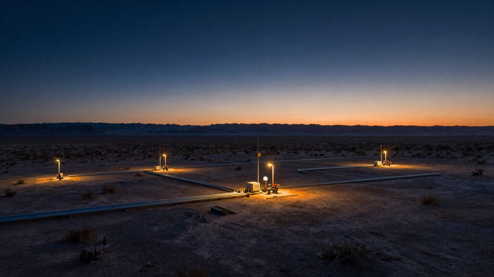
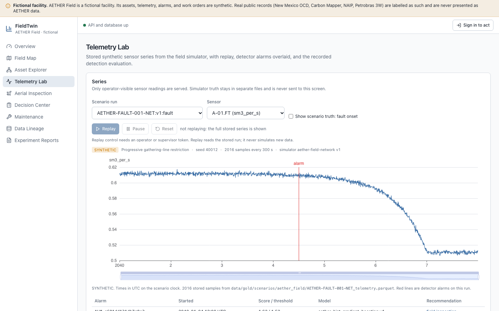
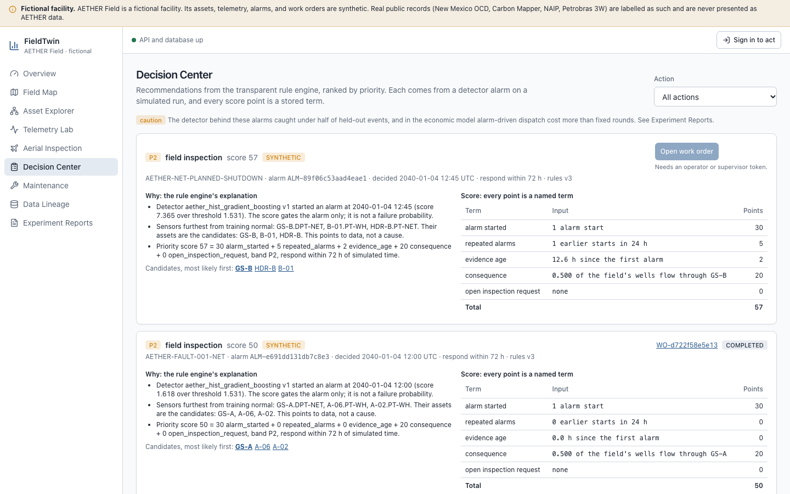
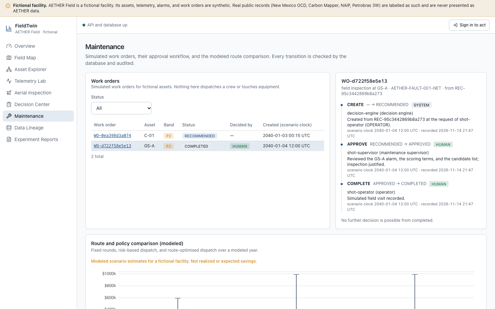
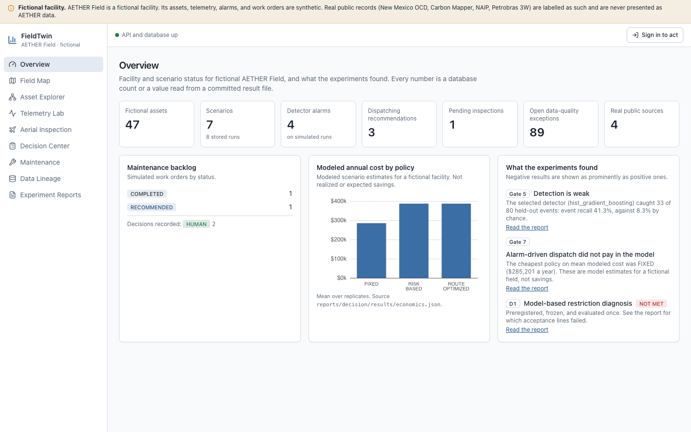
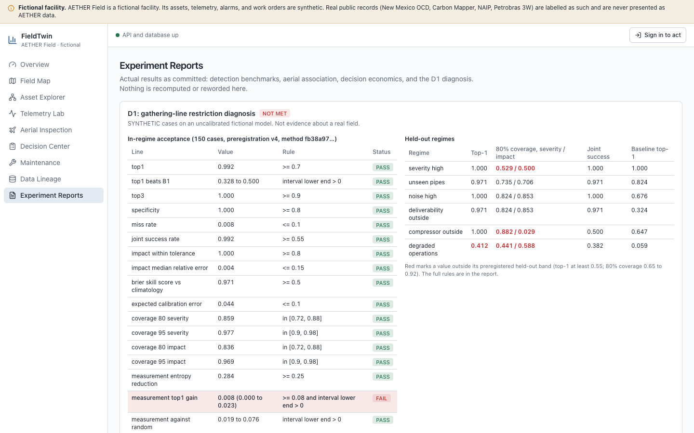
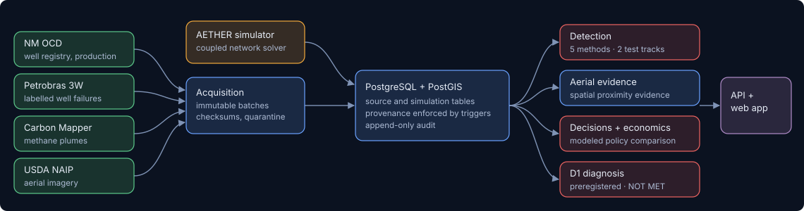
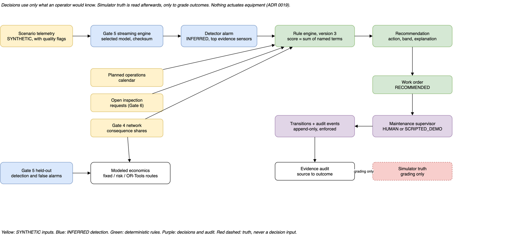
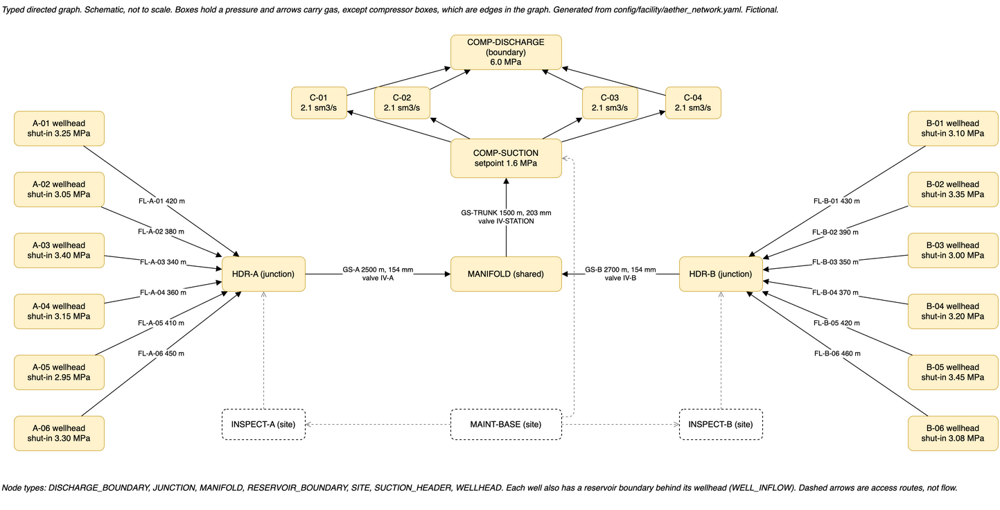

<div align="center">

# FieldTwin

### From field signals to approved action.

**Industrial decision support for inspection and maintenance.**

**[Live app](https://web-chi-amber-14.vercel.app)** · [Project page](https://abh2050.github.io/fieldtwin/) · [Run it locally](docs/demos/walkthrough.md) · [Architecture](#architecture) · [Results](#evaluation-results) · [Technical overview](docs/technical_overview.md)

> The live app is the browser demo build ([ADR 0023](docs/adr/0023-explicit-browser-demo.md)): the nine screens running on the six stored AETHER simulation runs, with work-order decisions kept in your browser session and labelled `SCRIPTED_DEMO`. The full system (FastAPI, PostGIS, database-enforced roles, aerial evidence) runs locally with `bash scripts/run_demo.sh`.

[](https://github.com/abh2050/fieldtwin/actions/workflows/ci.yml)

</div>



<sub>Industrial illustration generated with Higgsfield.</sub>

## The business problem

**Decide where to send the next crew.** When gas flow falls, an operator must narrow the cause: a well, a shared gathering restriction, or an instrumentation problem. A maintenance supervisor then needs to decide whether the evidence justifies a site visit and which work takes priority. Unnecessary dispatch adds travel and labour cost. Delayed repair can extend production losses.

The inputs span equipment hierarchies, sensor readings, production records, inspection evidence, and maintenance history. They use different identifiers, units, and reporting grains. The engineering challenge is to bring that context into a decision while preserving what each source actually establishes.

We built FieldTwin to connect monitoring, investigation, and maintenance in one auditable workflow, and to test whether alarm-driven dispatch can outperform scheduled rounds in a cost model. Every recommendation exposes its inputs and scoring terms; a supervisor approves the work; the audit trail records the decision and outcome.

| Investigate | Prioritize | Account for the decision |
| --- | --- | --- |
| Follow alarms through the equipment network and inspect the available readings. | Review candidate assets, scoring terms, response windows, and evidence gaps. | Record approval, rejection, or a request for evidence; compare modeled maintenance policies. |

## Inside the workspace

Nine React screens cover asset exploration, network topology, telemetry replay, inspections, decisions, maintenance, data lineage, and evaluation. These captures show the local demonstration dataset; telemetry and work orders are synthetic, and financial figures are modeled estimates.

### Investigate the signal

[](docs/assets/screens/telemetry.png)

Replay a stored run, inspect pressure and flow changes, and locate detector alarms on the scenario clock. The operational view uses operator-visible readings.

<table>
<tr>
<td width="50%" valign="top">
<h3>Explain the recommendation</h3>
<a href="docs/assets/screens/decisions.png"></a>
<p>Inspect the rule inputs and named terms behind each priority score before opening a work order.</p>
</td>
<td width="50%" valign="top">
<h3>Approve and track the work</h3>
<a href="docs/assets/screens/maintenance.png"></a>
<p>Follow supervisor approval and completion through a database-enforced, append-only audit trail.</p>
</td>
</tr>
<tr>
<td width="50%" valign="top">
<h3>Review the operating picture</h3>
<a href="docs/assets/screens/overview.png"></a>
<p>See asset status, maintenance backlog, modeled policy costs, and evaluation outcomes together.</p>
</td>
<td width="50%" valign="top">
<h3>Inspect the evaluation</h3>
<a href="docs/assets/screens/reports.png"></a>
<p>Compare held-out performance with acceptance thresholds and open the underlying reports.</p>
</td>
</tr>
</table>

Click any screenshot to open it at full resolution. [Walk through the application →](docs/demos/walkthrough.md)

## Architecture

Four public acquisition pipelines and a coupled field simulator feed PostgreSQL/PostGIS. Source records and simulation assets occupy separate tables. Detection, aerial proximity analysis, diagnosis, and decision support preserve those boundaries; FastAPI serves the results to React.

[](docs/assets/architecture.svg)

Petrobras 3W is a separate offshore detection benchmark. Public aerial evidence relates real plume detections to real registered wells by proximity; it does not identify an AETHER asset or establish an emissions source.

| Layer | Implementation | Responsibility |
| --- | --- | --- |
| Data acquisition | Python, source adapters, SHA-256 manifests | Immutable batches, validation, quarantine with reasons, source identity. |
| Canonical store | PostgreSQL 16, PostGIS | Asset and source models, reporting grain, provenance, reconciliation history. |
| Simulation and detection | NumPy, SciPy, scikit-learn | Coupled network scenarios, synthetic sensor series, five detectors on two separate evaluation tracks. |
| Decisions and economics | Deterministic rules, OR-Tools | Named scoring terms, approval workflow, modeled scheduling and route comparisons. |
| Application | FastAPI, React, TypeScript, MapLibre, ECharts | Nine screens, telemetry replay, role-based actions, source reports and audit history. |

### From alarm to approved work

[](reports/decision/decision_flow.png)

The engine uses alarms, planned operations, open inspection requests, and network consequence shares. A priority score is the sum of named terms, never a failure probability. A maintenance supervisor approves, rejects, or requests evidence. Actor labels distinguish `HUMAN`, `SCRIPTED_DEMO`, and `SYSTEM`. Simulator truth is reserved for outcome grading.

<details>
<summary><strong>Explore the physical network and simulation diagrams</strong></summary>

The simplified simulation connects two pads, twelve wells, three gathering segments, and four compressors. Physical connectivity lives in `physical_nodes` and `physical_edges`, separate from asset identity and evidence relationships.

[](reports/simulation/diagrams/aether_physical_network.png)

[Asset hierarchy](reports/simulation/diagrams/aether_asset_topology.png) · [Simulation sequence](reports/simulation/diagrams/simulation_sequence.png) · [Detection evaluation](reports/experiments/detection_evaluation.png) · [Aerial evidence pipeline](reports/inspection/aerial_evidence.png)

The [editable draw.io diagrams](docs/architecture.drawio) include system architecture, local runtime, physical connectivity, and evaluation. See the [technical overview](docs/technical_overview.md) for the layer-by-layer design.

</details>

## Run locally

Requires [uv](https://docs.astral.sh/uv/), Node 20 or later, Docker running, and about 7 GB of free disk. The first run downloads roughly 1.7 GB of public data; completed batches are reused. Acquisition stops if it would leave less than 5 GB free.

```bash
git clone https://github.com/abh2050/fieldtwin.git
cd fieldtwin
bash scripts/run_demo.sh
```

Open **http://127.0.0.1:8000**. The script prints local tokens for viewer, operator, and maintenance supervisor roles. Sign in as an operator to open a work order from a recommendation, then as a maintenance supervisor to review it. [Full walkthrough →](docs/demos/walkthrough.md)

The application runs on one machine without cloud accounts or paid API keys ([ADR 0022](docs/adr/0022-no-cloud-deployment.md)). The script rebuilds this project's local database and Docker volume. A first run can take tens of minutes while acquiring data and rebuilding the detector.

<details>
<summary><strong>Development commands, one gate at a time</strong></summary>

```bash
make bootstrap   # create the Python 3.12 environment
make test        # offline test suite
make acquire     # download real public data, about 1.6 GB
make profile     # data quality and cross-checks
make validate    # re-verify raw data against manifests

# Canonical database (Docker, PostGIS on port 55432)
make db-reset db-migrate db-seed db-load
make test-db     # database tests on committed fixtures

# Reconciliation and the synthetic scenario
make benchmark-events scenario reconcile gate3-reports

# The whole fictional field
make field field-reports

# Detection experiments: development first, then the holdout
make gate5-audit gate5-data gate5-development gate5-holdout gate5-reports

# Aerial evidence: Carbon Mapper plumes and NAIP chips near registry wells, proximity only
make gate6 inspection-load
make inspection-review   # chips awaiting blinded human review

# Decision support: recommendations, simulated work orders, modeled economics
make gate7 decision-load decision-reports
make decision-list       # then record a person's decision with pipelines.decision.decide

# The application: demo database without scripted decisions, local tokens, API and web
make app-db app-tokens
make app-api             # then, in another terminal: make app-web, and open http://127.0.0.1:5173
```

`make acquire` reuses a completed batch. `make acquire REFRESH=1` checks upstream for a new version. Detection rules are fixed before fitting; development selection is committed before opening a holdout.

</details>

## Evaluation results

Results are read from committed experiment files. The two detection tracks remain separate, and financial results are modeled estimates for the fictional simulation facility.

| Evaluation | Recorded result | Implication |
| --- | --- | --- |
| Synthetic AETHER detection | Selected detector caught **33 of 80** held-out events: **41.3%** recall, versus **8.3%** by chance. | Recall remains below half of events. |
| Offshore Petrobras 3W benchmark | Method selected on development wells caught **1 of 40** held-out events (**2.5%** recall). | Performance on AETHER does not establish performance on offshore wells. |
| Modeled maintenance economics | Mean annual cost: **$285,201** for fixed rounds; **$386,676** for alarm-driven dispatch, over 200 replicates. | Fixed rounds had the lowest mean cost under the declared assumptions. |
| Public aerial association | **34.7%** of plume origins had a registered well within 250 m, versus **17.0%** for a footprint-matched null. | Evidence of spatial proximity; source attribution remains unverified. |
| D1 restriction diagnosis | Preregistered outcome: **NOT MET**. Top-1 localization was **0.412** under held-out degraded operations. | Diagnosis did not meet its acceptance criteria. |

[Full evaluation tables and source hashes →](reports/portfolio/evaluation_summary.md) · [D1 final report](reports/diagnostics/final_report.md) · [Model assumptions and limitations](docs/limitations.md)

## Engineering controls

| Control | How it works |
| --- | --- |
| Complete provenance | Database triggers require a chain from synthetic readings to sensor, asset, scenario run, and parameters. |
| Restricted application access | FastAPI connects as `fieldtwin_app`; source ingestion and analysis writes stay outside the application's privileges. |
| Human approval | Role checks, allowed transitions, and required audit events are enforced in the database. |
| Explicit failure states | Failed acquisition, unavailable services, and unbuilt results retain their errors and recovery information. |
| Reproducible evaluation | Frozen configurations, source hashes, attempt ledgers, and committed result files support review. |

```bash
make test                                  # offline tests
npm --workspace apps/web run test           # UI behavior
npm --workspace apps/web run build          # type checking and production build
bash scripts/ci_local.sh                    # CI commands in a clean copy; needs PostGIS
bash scripts/clean_copy_demo.sh             # full rebuild and application smoke test
```

Implementation and evidence are organized by [development gate](docs/specification.md#18-development-gates): [0](reports/gates/gate_0.md), [1](reports/gates/gate_1.md), [2](reports/gates/gate_2.md), [3](reports/gates/gate_3.md), [4](reports/gates/gate_4.md), [5](reports/gates/gate_5.md), [6](reports/gates/gate_6.md), [7](reports/gates/gate_7.md), [D1](reports/diagnostics/final_report.md), [8](reports/gates/gate_8.md), and [10](reports/gates/gate_10.md). Cloud deployment (Gate 9) is outside scope.

<details>
<summary><strong>Repository map</strong></summary>

| Path | Contents |
|---|---|
| `config/` | Source definitions and the fictional facility |
| `data_contracts/` | What each source is expected to contain |
| `pipelines/acquire/` | Source adapters and shared download, manifest, and quarantine code |
| `pipelines/profile/` | Quality reports and integrity validation |
| `db/migrations/` | PostgreSQL and PostGIS schema |
| `packages/domain/` | Pydantic contracts and measurement rules |
| `packages/reconciliation/` | Identity, semantic, geospatial, provenance, scenario, and review modules |
| `packages/scenario_engine/` | Synthetic physical model, sensors, invariants, and events |
| `pipelines/normalize/` | Seeds, loaders, canonical validation, and generated reports |
| `pipelines/reconcile/`, `pipelines/synthetic/` | Run the engine and the scenario, and generate their reports |
| `packages/anomaly_detection/`, `pipelines/experiments/` | Gate 5 detectors, evaluation, and the attempt ledger |
| `packages/inspection/`, `pipelines/inspection/` | Gate 6 aerial evidence: association, claim guard, blind review |
| `packages/decision_engine/`, `packages/optimization/`, `pipelines/decision/` | Gate 7 rules, work orders, routing, modeled economics |
| `packages/diagnostics/`, `pipelines/diagnostics/` | D1 inverse diagnosis, freeze guard, and attempt control |
| `apps/api/`, `apps/web/` | The FastAPI API and the React dashboard (Gate 8) |
| `scripts/run_demo.sh`, `scripts/clean_copy_demo.sh` | One-command demo, and its proof from a clean copy |
| `data/manifests/` | Checksums and counts for each batch (tracked) |
| `data/raw`, `data/bronze` | Downloaded and parsed data (not tracked, recreated by `make acquire`) |
| `data/fixtures/` | Committed test data. Its OCD rows are hand-written, not source records. |
| `reports/` | Generated results and gate reports |
| `docs/` | [Specification](docs/specification.md), requirements, ADRs, architecture, and dataset documentation |

</details>

## Data provenance

AETHER is a fictional simulation model. Its operational assets, telemetry, alarms, and work orders are synthetic, generated by a simplified physical model that is uncalibrated to real wells. Economic figures are modeled estimates. FieldTwin provides advisory decision support with human approval and has no connection to physical equipment.

Public datasets retain their original identifiers, units, reporting grain, and quality flags. Petrobras 3W was measured offshore and stays a separate benchmark; New Mexico OCD, Carbon Mapper, and NAIP records retain their own source context.

| Class | Meaning |
| --- | --- |
| `OBSERVED` | Original source measurement or record. |
| `DERIVED` | Computed from identified source records. |
| `REPLAYED` | Stored source sequence retaining its original identity. |
| `SYNTHETIC` | Generated data, assets, events, or relationships. |
| `INFERRED` | Tentative association requiring supporting evidence. |

3W's simulated and hand-drawn instances are classified as `SYNTHETIC`.

**Data credits:** Petrobras 3W (CC BY 4.0; code Apache 2.0). New Mexico Oil Conservation Division (no stated redistribution terms; raw rows are not redistributed). Data by Carbon Mapper®, from data.carbonmapper.org (non-commercial use). USDA NAIP, accessed through Microsoft Planetary Computer (2022 imagery licensing unconfirmed). [Licence inventory →](docs/datasets/license_inventory.md)

## Explore further

| Product and design | Evidence and operation |
| --- | --- |
| [Live app](https://web-chi-amber-14.vercel.app) · [Project page](https://abh2050.github.io/fieldtwin/) | [Evaluation summary](reports/portfolio/evaluation_summary.md) |
| [Technical overview](docs/technical_overview.md) | [Security review](docs/security_review.md) |
| [Specification](docs/specification.md) | [Costs and teardown](reports/portfolio/costs.md) |
| [Architecture decisions](docs/adr/) | [Hardening roadmap](docs/roadmap.md) |
| [Canonical data model](reports/data_quality/canonical_schema.md) | [Decision evidence audit](reports/decision/evidence_audit.md) |
